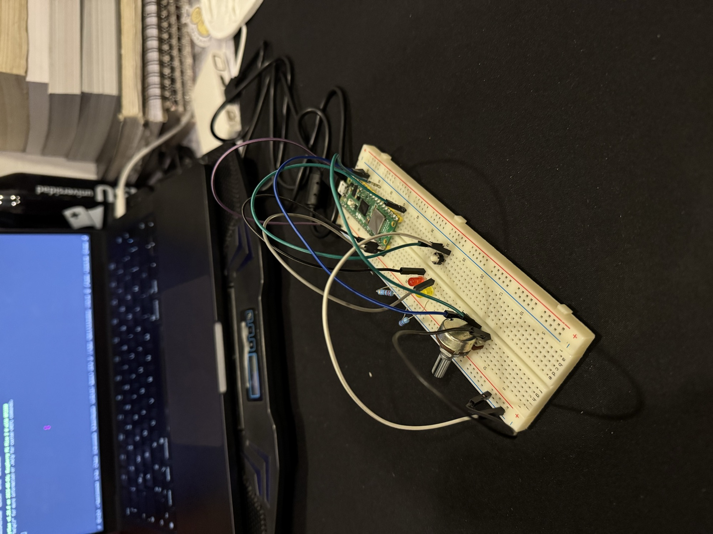
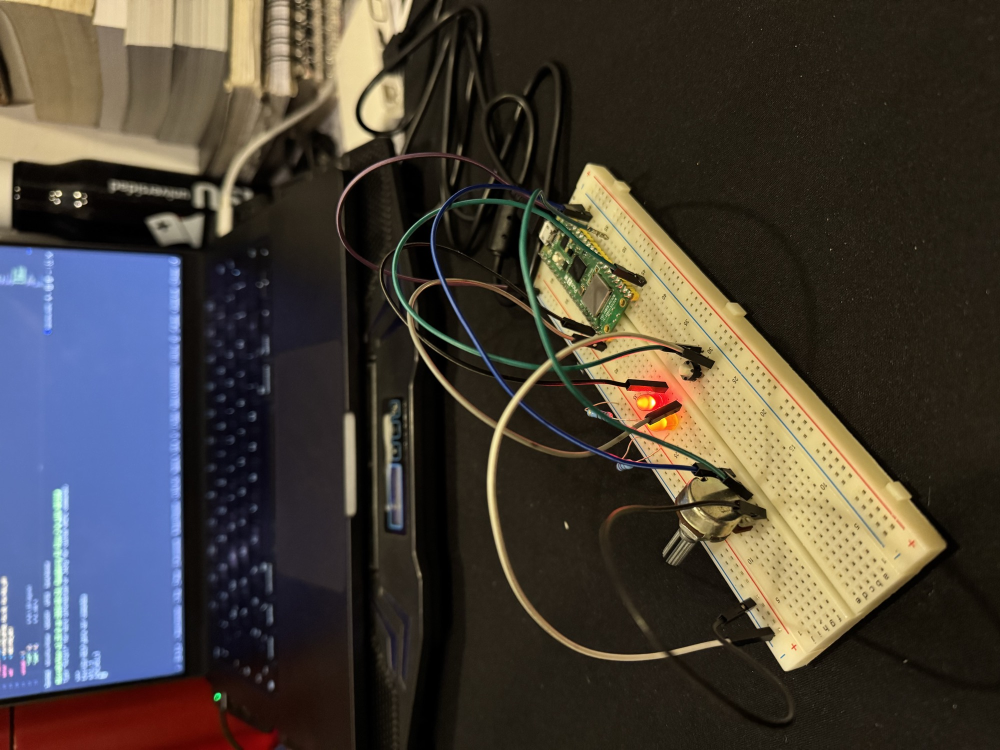
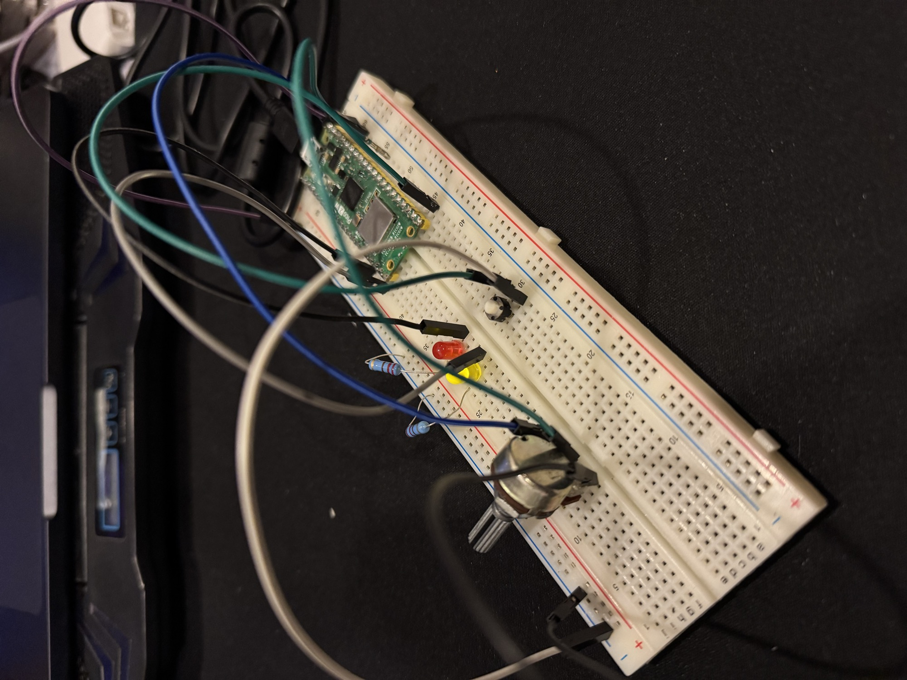
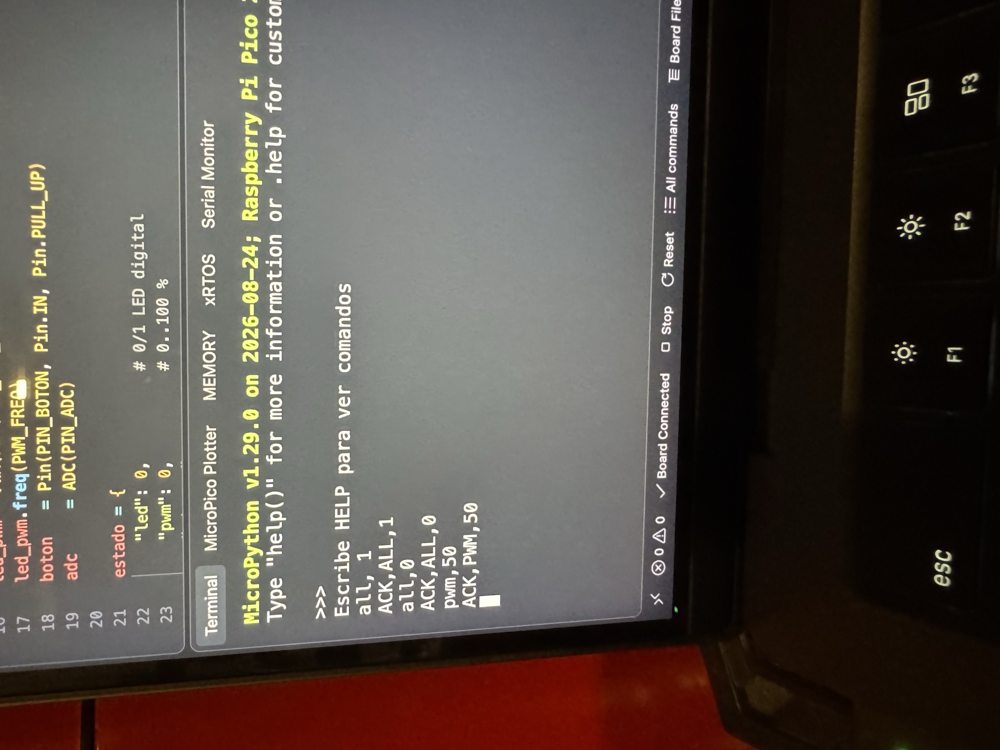

# Examen Práctico 02 · UART + PWM + ADC + Dual-Core
### Sistema de Control Serial Inteligente

**Laboratorio de Elementos Programables I**
**Fecha:** 23/10/2026
**Integrantes:**
- Jonathan Hernández Lazcano — 200417
- Camila Rodriguez Rosas — 194100
- Hamid Susen Santiago Garcia — 202744

---

## 1. Objetivo

Construir un único sistema embebido en una Raspberry Pi Pico 2 con MicroPython que **reciba comandos por serial**, controle un LED digital y un LED con **PWM**, lea un **botón** y un **potenciómetro (ADC)**, y mantenga la adquisición del ADC en **Core 1** sin detener la comunicación en **Core 0**.

Enunciado completo: [`Examen_Practico_02_UART_PWM_ADC_DualCore_v2.pdf`](Examen_Practico_02_UART_PWM_ADC_DualCore_v2.pdf)

---

## 2. Arquitectura Dual-Core

| Core 0 (`main`) | Core 1 (`tarea_core1`) |
|---|---|
| Lee comandos con `input()` (USB/REPL) | Lee el ADC cada 50 ms (promedio de 8 lecturas) |
| Parser `procesar()` → `ACK` / `ERR` / `STATUS` | Convierte a porcentaje 0–100 % |
| Controla el LED digital y el PWM | Incrementa `SAMPLES` |
| | Lee el botón con antirrebote (50 ms) y genera `EVENT,BTN_PRESSED` |

- Los dos núcleos comparten el diccionario `estado`, protegido con un `lock` (`_thread.allocate_lock()`).
- Un segundo `print_lock` evita que los mensajes de ambos núcleos se impriman encimados.
- `Ctrl+C` / **Stop** pone `corriendo = False`, detiene Core 1, apaga las salidas e imprime `STOPPED`.

```
Terminal ──USB──► input() ──► procesar() ──► LED / PWM ──► print(ACK|ERR|STATUS)
                                   ▲
                       estado{} + lock
                                   ▲
Core 1:  ADC (GP26) + botón (GP16) ──► adc_pct, adc_raw, btn, samples
```

---

## 3. Circuito y pines

| Elemento | Pin Pico | Función |
|---|---|---|
| LED digital (rojo) + resistencia | GP13 | Encendido / apagado |
| LED PWM + resistencia | GP15 | Brillo 0–100 % (PWM a 1 kHz) |
| Botón | GP16 | Entrada con `PULL_UP` (presionado = 0) |
| Potenciómetro (señal) | GP26 / ADC0 | Lectura analógica 0–3.3 V |
| Potenciómetro (extremos) | 3V3 / GND | Alimentación del divisor |

Diagrama para Wokwi: [`diagram.json`](diagram.json)

---

## 4. Comandos

No distingue mayúsculas (`pwm,50` = `PWM,50`) y se ignoran los espacios alrededor de cada campo.

| Comando | Acción | Respuesta |
|---|---|---|
| `PING` | Comprueba la comunicación | `PONG` |
| `LED,0` / `LED,1` | Apaga / enciende el LED digital | `ACK,LED,0` / `ACK,LED,1` |
| `PWM,n` | Brillo del LED PWM, `n` = 0…100 | `ACK,PWM,n` |
| `STATUS` | Estado completo del sistema | `STATUS,LED=…,PWM=…,ADC=…,BTN=…,SAMPLES=…,RAW=…` |
| `ALL,0` / `ALL,1` | Apaga todo / LED digital + PWM al 100 % | `ACK,ALL,0` / `ACK,ALL,1` |
| `TOGGLE` *(bonus)* | Invierte el LED digital | `ACK,TOGGLE,<nuevo valor>` |
| `HELP` *(bonus)* | Muestra la lista de comandos | Texto de ayuda |

**Botón:** cada presión cambia `BTN` entre 0 y 1 (funciona como interruptor con memoria) e imprime `EVENT,BTN_PRESSED` seguido de un `STATUS`.

**PWM:** el porcentaje se convierte a `duty_u16` con `pct * 65535 // 100`.

**ADC:** `read_u16()` (0–65535) se convierte a porcentaje con `raw * 100 // 65535`. `RAW` se incluye como campo extra al final de `STATUS`.

### Errores

| Entrada | Problema | Respuesta |
|---|---|---|
| `PWM,150` | Fuera de rango | `ERR,PWM_RANGE` |
| `LED,7` | Valor inválido | `ERR,BAD_VALUE` |
| `PWM` | Trama incompleta | `ERR,BAD_FORMAT` |
| `HOLA` | Comando desconocido | `ERR,UNKNOWN_COMMAND` |

Tras cualquier error el programa sigue funcionando; una excepción inesperada responde `ERR,INTERNAL,<detalle>` sin detener el sistema.

---

## 5. Cómo ejecutarlo

1. Armar el circuito según la tabla de pines.
2. Abrir la carpeta en VS Code con **MicroPico** (o en Thonny), conectar la Pico y ejecutar `main.py`.
3. Al aparecer `Escribe HELP para ver comandos`, escribir los comandos en la terminal.
4. Prueba de concurrencia: ejecutar `STATUS` dos veces con una pausa; `SAMPLES` aumenta sin enviar otros comandos.

---

## 6. Estructura

```
Examen2/
├── README.md
├── main.py
├── diagram.json
├── Examen_Practico_02_UART_PWM_ADC_DualCore_v2.pdf
├── Examen_Practico_02_UART_PWM_ADC_DualCore_v2.docx
└── Evidencia_Fisica/
    ├── 01_armado_fisico_leds_apagados.jpg
    ├── 02_armado_fisico_leds_encendidos.jpg
    ├── 03_armado_fisico_vista_cercana.jpg
    └── 04_terminal_comandos_ALL_PWM.jpg
```

---

## Evidencia

**Montaje físico:** Pico 2 en protoboard con potenciómetro, botón y los dos LEDs con sus resistencias.



**Salidas encendidas:** LED digital y LED PWM encendidos.



**Vista cercana del circuito**



**Terminal (MicroPico / VS Code):** respuestas a `ALL,1`, `ALL,0` y `PWM,50`.


