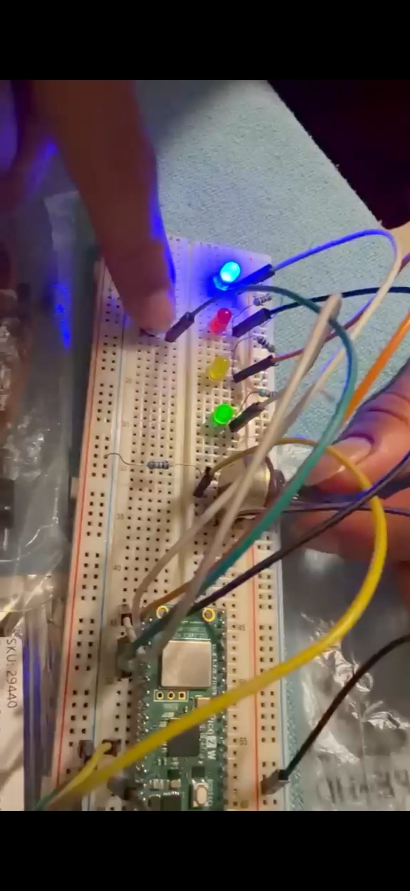

# Sesión 08 · Dual Core y Multitarea
### CHALLENGE 08 · Multitarea cooperativa con auto-calibración

**Laboratorio de Elementos Programables I**
**Alumnos:** Jonathan Hernández Lazcano - Camila Rodriguez Rosas
---

## 1. Objetivo

Construir un monitor analógico que ejecute **varias tareas a la vez** (sensado, botón, interfaz de LEDs y registro serial) sobre una Raspberry Pi Pico (W) con MicroPython, usando un **planificador cooperativo** de un solo núcleo, sin `_thread`.

```
potenciómetro → ADC → promedio móvil → auto-calibración → % → estado → LEDs / serial
                                                                  ↑
                                              botón (ACK / RESET) ┘
```

---

## 2. Multitarea cooperativa vs. dual-core

| | Cooperativa (este proyecto) | Dual-core (`_thread`) |
|---|---|---|
| Núcleos usados | 1 | 2 |
| Cómo se reparte el tiempo | Un bucle revisa qué tarea "ya toca" | Cada núcleo corre su propio bucle |
| Riesgo | Una tarea lenta **bloquea a todas** | Hay que sincronizar datos compartidos |

El bucle principal usa `ticks_ms()`, `ticks_diff()` y `ticks_add()` para decidir, en cada vuelta, qué tareas ya vencieron. Cada tarea debe terminar rápido para no retrasar a las demás.

La constante `STRESS_BLOCK_MS` permite probarlo: con `STRESS_BLOCK_MS = 500` la tarea de UI hace `sleep_ms(500)` y se bloquea **todo** el núcleo (baja la frecuencia de muestreo `fs` y el botón responde tarde). Es la base para comparar contra una versión dual-core, donde el sensor seguiría corriendo en el otro núcleo.

---

## 3. Circuito

| Componente | Pin Pico | Notas |
|---|---|---|
| Potenciómetro · cursor (SIG) | **GP26 / ADC0** | Extremos a 3V3 y GND |
| LED verde + 220 Ω | GP16 | Estado NORMAL |
| LED amarillo + 220 Ω | GP17 | Estado WARNING |
| LED rojo + 220 Ω | GP18 | Estado ALARM |
| LED azul + 220 Ω | GP19 | Heartbeat (el sistema está vivo) |
| Botón | GP20 → GND | `Pin.PULL_UP`: presionado = 0 |

Los cátodos de los LEDs van a GND. Rango seguro del ADC: 0 V ≤ entrada ≤ 3.3 V.

---

## 4. Tareas y periodos

| Tarea | Periodo | Responsabilidad |
|---|---|---|
| `sensor_task` | 2 ms (~500 Hz) | Leer ADC, filtrar, auto-calibrar y clasificar |
| `button_task` | 10 ms | Antirrebote (30 ms), pulsación corta/larga |
| `ui_task` | 200 ms | Actualizar LEDs y reportar cambios de estado |
| `log_task` | 1000 ms | Imprimir una línea de estado por serial |

Parámetros ajustables al inicio de `main.py`: `SENSOR_MS`, `BUTTON_MS`, `UI_MS`, `LOG_MS`, `WINDOW`, `WARN_PCT`, `ALARM_PCT`, `MIN_SPAN`, `DEBOUNCE_MS`, `LONG_PRESS_MS`, `STRESS_BLOCK_MS`.

---

## 5. Filtro y auto-calibración

- **Promedio móvil** de `WINDOW = 32` muestras, con suma acumulada (sin recorrer el buffer en cada lectura).
- **Auto-calibración:** el programa aprende el mínimo y el máximo reales de la señal **filtrada** mientras se gira el potenciómetro. Así funciona con cualquier pot (1k, 10k, 100k...) aunque no llegue a 0 V ni a 3.3 V. Se considera calibrado cuando el rango recorrido es de al menos `MIN_SPAN = 3000` (≈ 0.15 V).
- Mientras no esté calibrado, el porcentaje se mantiene en 0 % y el serial muestra `CALIBRANDO`.

```
pct = (avg - cal_min) / (cal_max - cal_min) × 100
```

**Uso:** arrancar el programa y girar el potenciómetro **una vez** de un extremo al otro.

---

## 6. Estados y LEDs

| Estado | Rango (% del rango calibrado) | LED |
|---|---|---|
| NORMAL | < 50 % | 🟢 verde fijo |
| WARNING | 50 % a < 75 % | 🟡 amarillo fijo |
| ALARM | ≥ 75 % | 🔴 rojo **parpadeando** (fijo tras ACK) |

El LED azul parpadea siempre en cada ciclo de UI como indicador de que el sistema no está colgado. Al salir de ALARM, el ACK se rearma automáticamente.

---

## 7. Botón

| Acción | Efecto |
|---|---|
| Pulsación corta | **ACK**: reconoce la alarma (LED rojo pasa a fijo). Se ignora si no hay alarma o ya fue reconocida |
| Pulsación larga (1 s) | **RESET**: reinicia filtro, contador y calibración |

---

## 8. Salida serial

Cada segundo se imprime una línea como:

```
raw=41230 avg=41188 pct=62.4% voltage=2.07V state=WARNING fs=498Hz ack=NO cal=1203..64210
```

| Campo | Significado |
|---|---|
| `raw` / `avg` | Lectura cruda y promedio móvil (0–65535) |
| `pct` | Porcentaje dentro del rango calibrado |
| `voltage` | Voltaje real en GP26 |
| `state` | NORMAL / WARNING / ALARM |
| `fs` | Frecuencia real de muestreo (útil en la prueba de estrés) |
| `ack` | Si la alarma fue reconocida |
| `cal` | Mínimo..máximo aprendidos |

Los cambios de estado generan además un evento: `[EVENT] NORMAL -> WARNING`. *(Los valores del ejemplo son ilustrativos.)*

---

## 9. Cómo ejecutarlo

**Wokwi:** abrir el proyecto, o importar `wokwi/diagram.json` junto con `main.py`.
**Pico física:** copiar `main.py` a la placa (Thonny o MicroPico/VS Code) y abrir el monitor serial.

Para la prueba de estrés, cambiar `STRESS_BLOCK_MS = 500`, volver a correr y observar cómo cae `fs` y el retraso del botón.

---

## 10. Estructura del proyecto

```
Sesion_08_Dual_Core_Multitarea/
├── README.md
├── main.py
├── wokwi/
│   ├── diagram.json
│   └── README.md
└── evidence/
    └── Armado.PNG
```

---

## Evidencia

**Montaje físico (Pico W en protoboard)**



- Simulación en Wokwi: https://wokwi.com/projects/477453120162961409
- Video del armado físico: https://youtube.com/shorts/y9N-Xi04YrA?feature=share

---

## Conclusión

Un planificador cooperativo basado en `ticks_ms` permite que sensado, botón, LEDs y registro serial convivan en un solo núcleo, siempre que ninguna tarea se bloquee. La prueba de estrés (`STRESS_BLOCK_MS`) muestra su límite: una sola tarea lenta degrada a todas, lo que motiva el uso del segundo núcleo. Además, la auto-calibración hace que el sistema funcione con cualquier potenciómetro sin editar el código.
