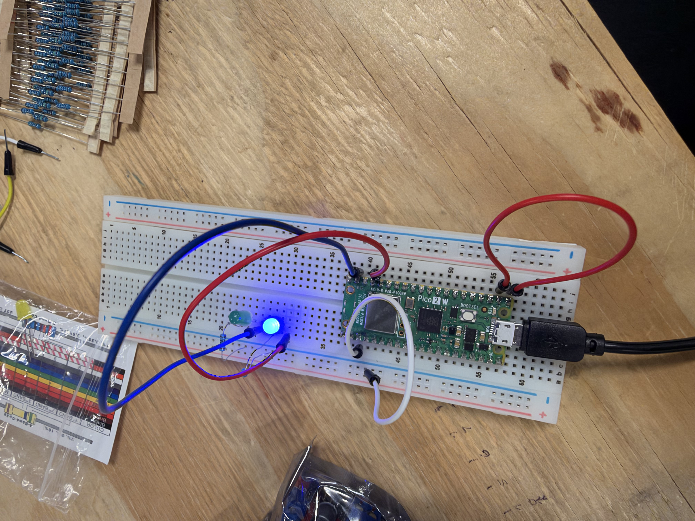
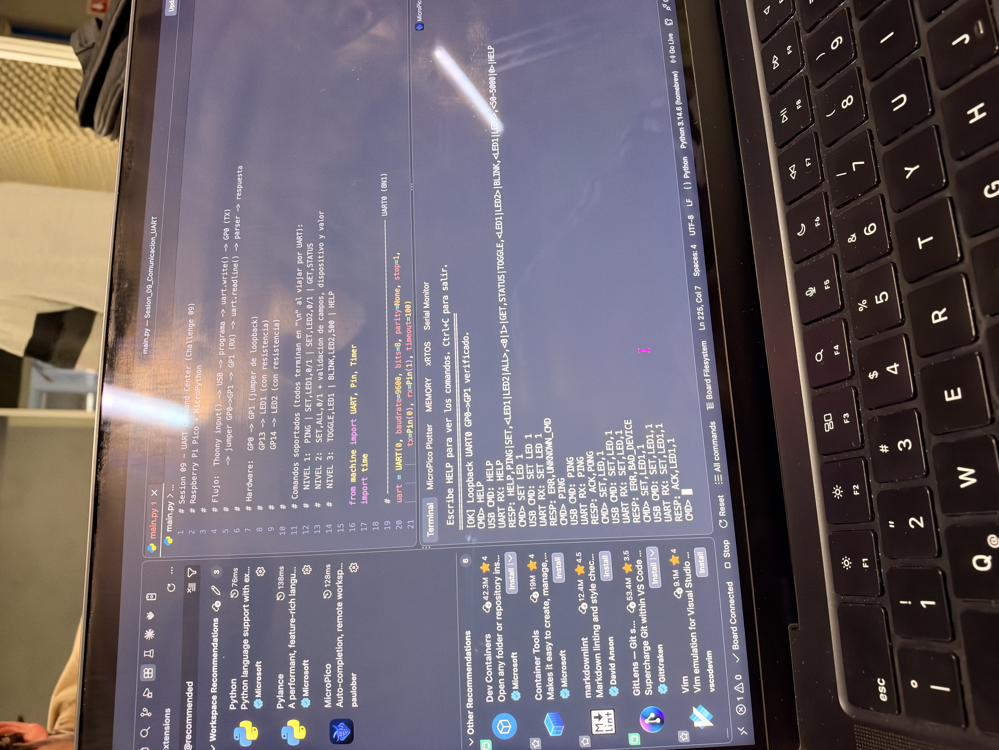

# Sesión 09 · Comunicación UART
### CHALLENGE 09 · UART Command Center

**Laboratorio de Elementos Programables I**
**Alumnos:**
- Jonathan Hernández Lazcano — 200417
- Camila Rodriguez Rosas — 194100

---

## 1. Objetivo

Construir un **centro de comandos por UART** en una Raspberry Pi Pico 2 W con MicroPython. El operador escribe un comando en la terminal, el programa lo transmite por el **UART0 físico** (GP0 → GP1 con un jumper), lo recibe de vuelta, lo interpreta y controla dos LEDs, respondiendo siempre con `ACK`, `ERR` o `STATUS`.

```
input() → USB → uart.write() → GP0 (TX) → jumper → GP1 (RX) → uart.readline() → parser → LEDs + respuesta
```

---

## 2. ¿Qué es UART?

**UART** (*Universal Asynchronous Receiver-Transmitter*) es un periférico de comunicación **serial**: envía los datos bit por bit sobre un solo cable.

- **Asíncrona:** no hay una línea de reloj compartida. Ambos lados se ponen de acuerdo de antemano en la velocidad (baud rate) y se sincronizan con el **bit de inicio** de cada byte.
- **Full-duplex:** tiene una línea para transmitir y otra para recibir, así que puede hacer las dos cosas al mismo tiempo.
- **Punto a punto:** conecta exactamente dos dispositivos.
- En reposo la línea está en **alto (1)**. Un byte empieza cuando la línea baja a 0 (bit de inicio).

---

## 3. TX y RX

| Señal | Función |
|---|---|
| **TX** (*transmit*) | Pin por donde el dispositivo **envía** datos |
| **RX** (*receive*) | Pin por donde el dispositivo **recibe** datos |

Las líneas se **cruzan**: el TX de un dispositivo va al RX del otro, y los dos comparten **GND**.

```
Dispositivo A            Dispositivo B
     TX  ───────────────►  RX
     RX  ◄───────────────  TX
     GND ────────────────  GND
```

En la Pico, **UART0** usa **GP0 = TX** y **GP1 = RX**.

---

## 4. Baud rate y 8N1

```python
uart = UART(0, baudrate=9600, bits=8, parity=None, stop=1, tx=Pin(0), rx=Pin(1))
```

- **Baud rate = 9600:** 9600 bits por segundo, así que cada bit dura ≈ 104 µs. Los dos extremos deben usar **la misma** velocidad; si no coinciden, llegan bytes basura.
- **8N1:** **8** bits de datos, **N**o paridad, **1** bit de stop.

Trama de un byte en la línea:

```
reposo  start  D0 D1 D2 D3 D4 D5 D6 D7  stop  reposo
  1      0     ── 8 bits de datos ──     1      1
```

Cada byte ocupa **10 bits** (1 start + 8 datos + 1 stop), unos 1.04 ms a 9600 baud. Eso equivale a ~960 bytes/s útiles.

---

## 5. USB/REPL ≠ UART

Son **dos canales distintos**:

| | USB / REPL | UART0 |
|---|---|---|
| Hardware | Puerto micro-USB (USB-CDC virtual) | Periférico UART en GP0/GP1 |
| Lo usan | `print()`, `input()`, la terminal del editor | `uart.write()`, `uart.read()`, `uart.readline()` |
| Conexión | Cable USB a la computadora | Cables/jumpers en los pines |

Un `print()` **no** sale por GP0, y lo que llega a GP1 **no** aparece solo en la terminal. En este proyecto el USB es solo la "consola del operador". El comando viaja de verdad por el UART: el programa lo escribe con `uart.write()` y lo vuelve a leer con `uart.readline()`.

---

## 6. ¿Por qué GP0 → GP1? (loopback)

Conectar el **TX con el RX del mismo UART** (*loopback*) permite probar la comunicación serial **real** sin un segundo dispositivo:

- Todo lo que se transmite por GP0 regresa por GP1, así que se ejercita el periférico, el baud rate, el formato 8N1 y el parser.
- Si se quita el jumper, el programa deja de recibir y responde `ERR,NO_UART_RX`. Eso demuestra que el dato no "hace trampa" por software.
- Al arrancar, `loopback_selftest()` envía `LOOP,0` y verifica que regrese igual:

```
[OK] Loopback UART0 GP0->GP1 verificado.
```

---

## 7. Circuito

| Componente | Pin Pico | Notas |
|---|---|---|
| Jumper loopback | **GP0 (TX) → GP1 (RX)** | Pines físicos 1 y 2 |
| LED1 + 220 Ω | GP13 | Cátodo a GND |
| LED2 + 220 Ω | GP14 | Cátodo a GND |

---

## 8. Formato de trama

- Texto **ASCII**, campos separados por **comas** y terminado en **`\n`** (salto de línea).
- No distingue mayúsculas: `set,led1,1` equivale a `SET,LED1,1`. Se ignoran los espacios alrededor de cada campo.

```
COMANDO,ARG1,ARG2\n
```

| Campo | Ejemplo | Significado |
|---|---|---|
| `COMANDO` | `SET` | Acción a ejecutar |
| `ARG1` | `LED1` | Dispositivo |
| `ARG2` | `1` | Valor |

`uart.readline()` lee hasta el `\n`, así que **el `\n` marca el fin de la trama**. Después, el parser separa los campos con `split(",")` y valida su número, el dispositivo y el valor.

---

## 9. Comandos y respuestas (ACK / ERR / STATUS)

El parser **siempre** responde una sola línea, que empieza con alguno de estos tipos:

| Tipo | Significado | Ejemplo |
|---|---|---|
| `ACK` | El comando se entendió y **se ejecutó** | `ACK,LED1,1` |
| `ERR` | El comando se rechazó; indica **por qué** | `ERR,BAD_DEVICE` |
| `STATUS` | Reporte del estado actual de las salidas | `STATUS,LED1,1,LED2,0` |

### Comandos

| Nivel | Comando | Respuesta |
|---|---|---|
| 1 | `PING` | `ACK,PONG` |
| 1 | `SET,LED1,<0\|1>` / `SET,LED2,<0\|1>` | `ACK,LED1,1` |
| 1 | `GET,STATUS` | `STATUS,LED1,<v>,LED2,<v>` |
| 2 | `SET,ALL,<0\|1>` | `ACK,ALL,0` |
| 3 | `TOGGLE,<LED1\|LED2>` | `ACK,LED1,<nuevo valor>` |
| 3 | `BLINK,<LED1\|LED2>,<50–5000>` | `ACK,BLINK,LED2,500` (parpadeo con `Timer`, no bloquea) |
| 3 | `BLINK,<LED1\|LED2>,0` | `ACK,BLINK,LED2,0` (detiene el parpadeo) |
| 3 | `HELP` | Lista de comandos |

### Errores

| Código | Causa |
|---|---|
| `ERR,EMPTY_FRAME` | Trama vacía |
| `ERR,UNKNOWN_CMD` | Comando no reconocido (texto libre) |
| `ERR,BAD_DEVICE` | Dispositivo no válido (ej. `LED3`) |
| `ERR,BAD_VALUE` | Valor fuera de `0/1` o no numérico |
| `ERR,BAD_PERIOD` | Periodo de `BLINK` fuera de 50–5000 ms |
| `ERR,BAD_SET_FRAME`, `ERR,BAD_GET_FRAME`, `ERR,BAD_PING_FRAME`, `ERR,BAD_HELP_FRAME`, `ERR,BAD_TOGGLE_FRAME`, `ERR,BAD_BLINK_FRAME` | Número de campos incorrecto |
| `ERR,NO_UART_RX` | No llegó nada por GP1 (jumper desconectado) |

### Ejemplo de sesión

```
CMD> SET,LED1,1
USB CMD: SET,LED1,1
UART RX: SET,LED1,1
RESP: ACK,LED1,1
```

---

## 10. Tabla de pruebas

Registro completo en [`tabla_pruebas.csv`](tabla_pruebas.csv).

| # | Comando | Respuesta esperada | Respuesta obtenida | Resultado |
|---|---|---|---|---|
| 1 | `PING` | `ACK,PONG` | `ACK,PONG` | ✅ PASS |
| 2 | `SET,LED1,1` | `ACK,LED1,1` | `ACK,LED1,1` | ✅ PASS |
| 3 | `SET,LED2,1` | `ACK,LED2,1` | `ACK,LED2,1` | ✅ PASS |
| 4 | `SET,ALL,0` | `ACK,ALL,0` | `ACK,ALL,0` | ✅ PASS |
| 5 | `GET,STATUS` | `STATUS,LED1,0,LED2,0` | `STATUS,LED1,0,LED2,0` | ✅ PASS |
| 6 | `SET,LED3,1` | `ERR,BAD_DEVICE` | `ERR,BAD_DEVICE` | ✅ PASS |
| 7 | `SET,LED1,9` | `ERR,BAD_VALUE` | `ERR,BAD_VALUE` | ✅ PASS |
| 8 | `texto libre` | `ERR,UNKNOWN_CMD` | `ERR,UNKNOWN_CMD` | ✅ PASS |

**Resultado: 8/8 pruebas aprobadas.**

---

## 11. Cómo ejecutarlo

1. Armar el circuito y colocar el jumper **GP0 → GP1**.
2. Abrir la carpeta en VS Code con la extensión **MicroPico**, conectar la Pico y ejecutar `main.py` (o subirlo a la placa).
3. En la terminal de MicroPico, verificar el mensaje `[OK] Loopback ...` y escribir los comandos tras `CMD>`.
4. `Ctrl+C` detiene el programa y apaga los LEDs.

---

## 12. Exit ticket

| # | Pregunta | Respuesta |
|---|---|---|
| 1 | ¿Por qué TX se conecta a RX? | Porque lo que un dispositivo **transmite** por su TX lo tiene que **escuchar** el otro por su RX; si se conectara TX con TX, los dos estarían "hablando" por el mismo cable y nadie recibiría. |
| 2 | ¿Qué ocurre si los baud rates no coinciden? | El receptor muestrea los bits en momentos equivocados y llegan **bytes basura** (caracteres corruptos o errores de decodificación), así que el parser responde `ERR`. |
| 3 | ¿Qué función convierte bytes en texto? | `bytes.decode()`; en el código, `data.decode().strip()` convierte lo que entrega `uart.readline()` en un `str` sin el `\n`. |
| 4 | ¿Qué ventaja tiene `SET,LED1,1` sobre una frase libre? | Tiene un **formato fijo** (comando, dispositivo, valor) que se separa con `split(",")` y se valida campo por campo, así que no hay ambigüedad y cualquier error se detecta con un código preciso. |
| 5 | ¿Cuál es la diferencia entre ACK y ERR? | `ACK` confirma que el comando se entendió y **se ejecutó**; `ERR` indica que se **rechazó** y explica por qué (ej. `ERR,BAD_DEVICE`), sin cambiar las salidas. |

---

## 13. Estructura del proyecto

```
Sesion_09_Comunicacion_UART/
├── README.md
├── main.py
├── tabla_pruebas.csv
└── evidencia/
    ├── IMG_0219.jpeg
    └── IMG_0220.jpeg
```

---

## Evidencia

**Montaje físico (Pico 2 W en protoboard)**

Jumper de loopback GP0 → GP1 y LEDs en GP13 / GP14 con sus resistencias.



**Prueba en terminal (MicroPico / VS Code)**

Loopback verificado al arrancar, y respuestas a `HELP`, `PING`, `SET,LED1,1` y comandos inválidos (`ERR,UNKNOWN_CMD`, `ERR,BAD_DEVICE`).



**Video de la prueba física:** https://youtube.com/shorts/psTezm2v7y4
