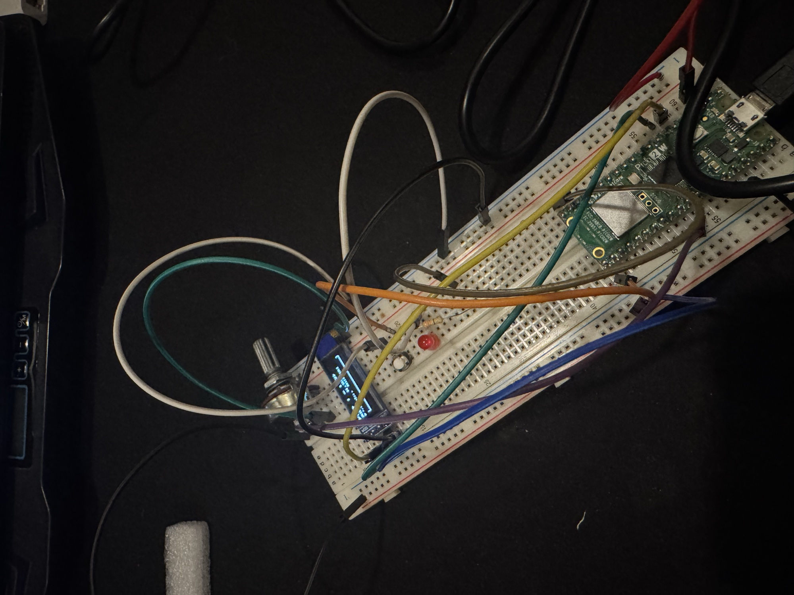
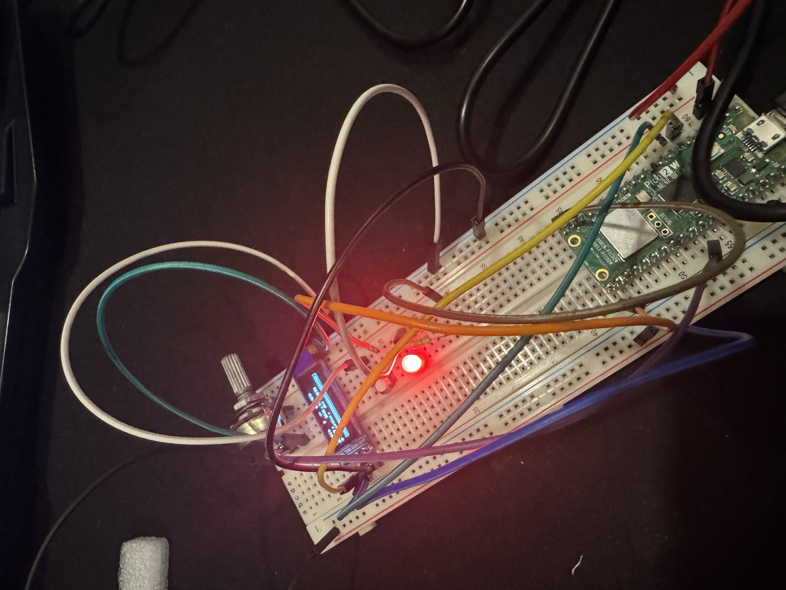

# Sesión 10 · Comunicación I2C + OLED HMI
### CHALLENGE 10 · Smart I2C HMI Monitor

**Laboratorio de Elementos Programables I**
**Alumnos:**
- Jonathan Hernández Lazcano — 200417
- Camila Rodriguez Rosas — 194100

---

## 1. Objetivo

Construir una **HMI (interfaz humano-máquina)** en una Raspberry Pi Pico con MicroPython que muestra en una pantalla **OLED SSD1306** conectada por **I2C** el valor de un potenciómetro, su estado (NORMAL / WARNING / ALARM) y datos del bus. Un botón cambia entre **3 páginas** y un LED se enciende cuando el sistema entra en **ALARM**.

```
Potenciómetro → ADC (GP26) → % → classify() → LED ALARM (GP15)
                                     │
Botón (GP16) → página ──► fill() → dibujar página → show() → I2C0 → OLED 0x3C
```

---

## 2. Estructura del repositorio

```
Sesion_10_Comunicacion_I2C_OLED_HMI/
├── main.py         # Programa principal (bus, HMI, lógica de ALARM)
├── ssd1306.py      # Driver del display SSD1306
├── diagram.json    # Circuito de Wokwi
├── README.md
└── evidence/
    ├── fisico.jpg
    └── fisico_alarm.jpg
```

---

## 3. Bus I2C

```python
i2c = I2C(0, sda=Pin(4), scl=Pin(5), freq=400_000)
devices = i2c.scan()
```

| Parámetro | Valor |
|---|---|
| Periférico | **I2C0** |
| **SDA** (datos) | **GP4** |
| **SCL** (reloj) | **GP5** |
| Frecuencia | **400 kHz** (Fast Mode) |
| Alimentación OLED | 3V3 y GND |
| Dirección OLED | **0x3C** (decimal **60**) |

### Resultado del scan

```
Decimal: [60]
Hex: ['0x3c']
OLED detectado en 0x3c
```

`i2c.scan()` devuelve la lista de direcciones en **decimal**; por eso se imprime también convertida a **hex**, que es como vienen en las hojas de datos. El programa busca el OLED en las dos direcciones típicas del SSD1306 (`0x3C` y `0x3D`) y, si no lo encuentra, sigue funcionando (LED y muestreo) e indica qué revisar.


---

## 4. Circuito

| Componente | Pin Pico | Notas |
|---|---|---|
| OLED SDA / SCL | GP4 / GP5 | Bus I2C0 |
| OLED VCC / GND | 3V3 / GND | |
| Potenciómetro SIG | GP26 (ADC0) | Extremos a 3V3 y GND |
| Botón | GP16 → GND | `PULL_UP` interno: presionado = 0 |
| LED ALARM | GP15 → 330 Ω → LED → GND | |

El circuito completo está en [`diagram.json`](diagram.json) ([proyecto en Wokwi](https://wokwi.com/projects/479354667469490177)).

---

## 5. HMI · las 3 páginas

El botón cambia de página en ciclo **1 → 2 → 3 → 1**. Se detecta el **flanco de bajada** (1 → 0) con un **antirrebote de 35 ms** basado en `ticks_ms()`, sin bloquear el programa. La pantalla se refresca cada **100 ms**.

| Página | Título | Qué muestra |
|---|---|---|
| **1** | `PAGE 1 - LIVE` | Lectura del ADC en %, estado actual y **barra de progreso** proporcional al valor |
| **2** | `PAGE 2 - I2C` | Pines SDA/SCL, frecuencia del bus en kHz, dirección del OLED y todos los dispositivos del scan |
| **3** | `PAGE 3 - STATS` | Valor **mínimo** y **máximo** registrados y número de **muestras** tomadas |

Cada refresco sigue el mismo patrón: `oled.fill(0)` (borrar) → dibujar la página → `oled.show()` (enviar al display).

| LIVE | I2C | STATS |
|---|---|---|
|  |  |  |

---

## 6. Lógica de ALARM

El ADC entrega un valor de 0 a 65535 que se convierte a porcentaje:

```python
percent = adc.read_u16() * 100.0 / 65535
```

| Rango | Estado | LED GP15 |
|---|---|---|
| `percent < 50` | **NORMAL** | Apagado |
| `50 ≤ percent < 75` | **WARNING** | Apagado |
| `percent ≥ 75` | **ALARM** | **Encendido** |

```python
def classify(percent):
    if percent < 50:
        return "NORMAL"
    if percent < 75:
        return "WARNING"
    return "ALARM"

led_alarm.value(1 if state == "ALARM" else 0)
```

La lectura, la clasificación y el LED se ejecutan en **cada vuelta** del bucle (cada ~20 ms), sin importar la página que se esté viendo. Así la alarma responde aunque el usuario esté en la página I2C o STATS. Si el OLED se desconecta, el error se captura y el monitoreo sigue corriendo.

---

## 7. Evidencia

- Capturas de la simulación en **Wokwi**: [`scan.png`](evidence/scan.png), [`live.png`](evidence/live.png), [`i2c.png`](evidence/i2c.png), [`stats.png`](evidence/stats.png)
- 🎥 **Video del funcionamiento físico:** [YouTube Short](https://youtube.com/shorts/cm7nNhgD_3A?feature=share)
- Fotos del circuito físico con OLED (Raspberry Pi Pico 2 W):

| Estado NORMAL (LED apagado) | Estado ALARM (LED encendido) |
|---|---|
|  |  |

---

## 8. Reflexión · ¿Por qué varios dispositivos comparten SDA/SCL?

I2C es un **bus**: todos los dispositivos se conectan en paralelo a las mismas dos líneas. Esto ahorra pines (un sensor, una pantalla y una memoria usan solo 2 pines del microcontrolador en lugar de 2 cada uno) y simplifica el cableado.

Es posible porque:

1. **Cada dispositivo tiene una dirección única** de 7 bits. El maestro (la Pico) inicia cada transacción enviando la dirección, y solo el dispositivo que la reconoce responde con un **ACK**; los demás ignoran el resto del mensaje.
2. **Las líneas son de drenador abierto** (*open-drain*) con resistencias **pull-up**: los dispositivos solo pueden jalar la línea a 0 o soltarla. Nadie fuerza un 1, así que no hay cortocircuito aunque dos dispositivos actúen a la vez.
3. **Solo el maestro genera el reloj (SCL)**, así que todos se sincronizan con la misma señal.

---

## 9. Exit ticket

**1. ¿Qué diferencia fundamental hay entre UART e I2C?**
UART es **asíncrona y punto a punto**: no hay reloj compartido (ambos lados acuerdan el baud rate) y conecta solo dos dispositivos con TX/RX cruzados. I2C es **síncrona y de bus**: el maestro genera un reloj en SCL y varios dispositivos comparten las mismas dos líneas, distinguiéndose por su dirección.

**2. ¿Qué significan SDA y SCL?**
**SDA** = *Serial Data*, la línea por donde viajan los datos (en ambos sentidos). **SCL** = *Serial Clock*, la línea de reloj que genera el maestro y que marca cuándo se lee cada bit de SDA. En este proyecto: SDA = GP4, SCL = GP5.

**3. ¿Qué devuelve `i2c.scan()`?**
Una **lista de enteros** con las direcciones de 7 bits de todos los dispositivos que respondieron con ACK en el bus. Las direcciones aparecen en **decimal**; en este proyecto devuelve `[60]`. Si la lista está vacía, no hay ningún dispositivo bien conectado.

**4. ¿Por qué 60 y 0x3C son el mismo valor?**
Es el mismo número escrito en dos bases. `0x3C` está en hexadecimal: 3 × 16 + 12 (C) = 48 + 12 = **60** en decimal. En binario es `0111100`. `scan()` lo imprime en decimal y las hojas de datos lo escriben en hex.

**5. ¿Por qué hace falta `oled.show()`?**
Las funciones de dibujo (`text`, `rect`, `fill_rect`, `fill`) solo modifican un **framebuffer en la RAM de la Pico**; no envían nada al display. `show()` transmite ese buffer completo (128 × 64 / 8 = 1024 bytes) por I2C a la memoria del SSD1306. Sin `show()` la pantalla no cambia. Además, dibujar todo primero y enviarlo de una sola vez evita parpadeos y reduce el tráfico en el bus.

**6. ¿Cómo comparten bus dos dispositivos sin confundirse?**
Por **direccionamiento**. Cada transacción empieza con una condición START seguida de la dirección del dispositivo destino. Solo el que tiene esa dirección responde con ACK y participa; los demás permanecen en silencio hasta el siguiente START. Por eso dos dispositivos en el mismo bus **deben tener direcciones distintas** (por ejemplo, un OLED en 0x3C y otro configurado en 0x3D). Las líneas open-drain con pull-up evitan cortocircuitos eléctricos entre ellos.

---