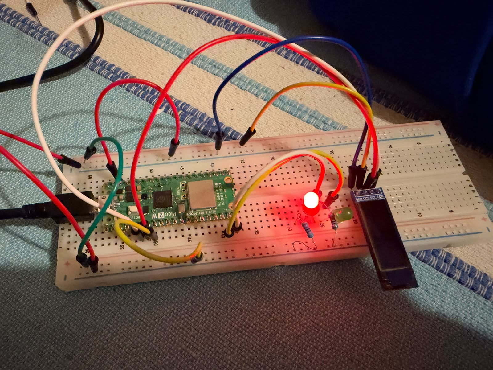
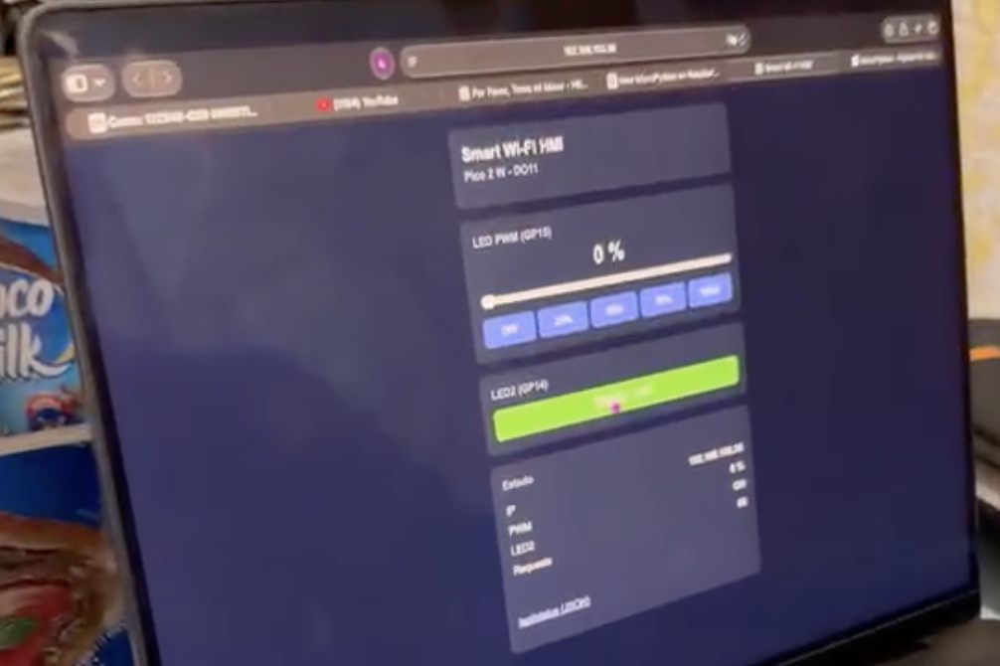

# Sesión 11 · Wi-Fi + HTTP + Sockets + HMI
### DO11 · Smart Wi-Fi HMI

**Laboratorio de Elementos Programables I**
**Alumno:** Jonathan Hernández Lazcano — 200417
**Alumno:** Camila Rodriguez Rosas — 194100

---

## 1. Objetivo

Convertir una **Raspberry Pi Pico 2 W** (MicroPython) en un servidor web que sirve un **dashboard HMI**: desde el navegador se controla el brillo de un LED por **PWM** con un slider, se conmuta un segundo LED y se consulta el estado del sistema, que también se muestra en una pantalla **OLED SSD1306** por I2C.

```
Navegador ──HTTP──► Pico 2 W (socket :80, modo STA)
                        │
                        ├── /api/pwm?value=N ──► PWM GP15 ──► LED 1
                        ├── /api/led2/toggle ──► GPIO GP14 ──► LED 2
                        ├── /api/status ───────► JSON con el estado
                        └── update_oled() ─────► I2C0 (GP4/GP5) ──► OLED
```

---

## 2. Estructura del repositorio

```
Sesion_11_WiFi_HTTP_Sockets_HMI/
├── main.py            # Servidor HTTP, API, dashboard y control de hardware
├── diagram.json       # Circuito de Wokwi
├── README.md
└── evidence/
    ├── ArmadoFisico.jpeg
    ├── DashboardWeb.png
    └── README.md      # Enlace al video
```

Archivos que deben estar en la **raíz de la Pico**: `main.py`, el archivo de credenciales y `ssd1306.py` (driver de la OLED, igual al de la [Sesión 10](../Sesion_10_Comunicacion_I2C_OLED_HMI/ssd1306.py)).

---

## 3. Circuito

| Componente | Pin Pico | Notas |
|---|---|---|
| LED 1 (PWM) | GP15 → 220 Ω → LED → GND | PWM a 1 kHz, `duty_u16` |
| LED 2 (ON/OFF) | GP14 → 220 Ω → LED → GND | Salida digital |
| OLED SDA | GP4 | I2C0, 400 kHz |
| OLED SCL | GP5 | I2C0, 400 kHz |
| OLED VCC / GND | 3V3 / GND | Dirección `0x3C` |

El circuito completo está en [`diagram.json`](diagram.json).

---

## 4. Configuración de Wi-Fi

`main.py` importa las credenciales de un módulo local que **no se sube a GitHub**:

```python
from secrets_template import WIFI_SSID, WIFI_PASSWORD
```

Contenido del archivo (en la Pico):

```python
WIFI_SSID = "mi_red"
WIFI_PASSWORD = "mi_password"
```

- La Pico trabaja en **modo STA**: debe estar en la **misma red** que la laptop.
- Solo funciona en redes de **2.4 GHz**.
- Si la conexión falla (status negativo o timeout de 20 s), la OLED muestra `ERROR WI-FI` y se imprime la causa por el puerto serie.

---

## 5. API HTTP

Solo se acepta el método **GET**. Todas las respuestas incluyen `Content-Length` y `Connection: close`.

| Ruta | Acción | Respuesta |
|---|---|---|
| `/` | Dashboard HTML | Página web |
| `/api/status` | Consultar estado | JSON |
| `/api/pwm?value=N` | PWM de GP15 al `N` % (0–100) | JSON con el estado |
| `/api/led2/toggle` | Invierte LED 2 (GP14) | JSON con el estado |
| `/pwm/N` | Atajo para botones fijos (0, 25, 50…) | JSON con el estado |
| `/favicon.ico` | — | `204 No Content` |

Ejemplo de respuesta de `/api/status`:

```json
{"ip": "192.168.1.50", "pwm": 50, "led2": 1, "requests": 12}
```

### Manejo de errores

El servidor nunca se detiene ante una petición inválida:

| Código | Causa |
|---|---|
| `400` | `value` ausente, no numérico, negativo, decimal o fuera de 0–100; petición mal formada |
| `404` | Ruta inexistente |
| `405` | Método distinto de GET |

```json
{"error": "value debe ser un entero entre 0 y 100", "code": 400}
```

---

## 6. Dashboard web

Página estática (la Pico solo envía HTML una vez; los datos llegan por `fetch` a `/api/status`):

- **Slider** 0–100 % y botones rápidos `OFF / 25 / 50 / 75 / 100 %` para el LED PWM.
- Botón **TOGGLE** para LED 2 (cambia de color según el estado).
- Tabla de estado: IP, PWM, LED 2 y número de requests.
- Actualización automática cada 5 s (se pausa mientras se arrastra el slider).
- Mensajes de error visibles si la Pico rechaza la petición o no hay conexión.

---

## 7. OLED

Muestra, en 5 líneas, el estado actual y se refresca tras cada petición:

```
WIFI DASHBOARD
192.168.1.50
PWM: 50%
LED2: ON
REQ: 12
```

Si la OLED no se detecta en el escaneo I2C, el servidor **sigue funcionando** sin pantalla.

---

## 8. Uso

1. Copiar `main.py`, `ssd1306.py` y el archivo de credenciales a la Pico.
2. Reiniciar la Pico y esperar el mensaje en la consola:
   ```
   SMART WI-FI HMI LISTO (DO11)
   Dashboard: http://<IP>/
   ```
3. Abrir `http://<IP>/` (la IP también aparece en la OLED).
4. Probar la API desde terminal:
   ```bash
   curl http://<IP>/api/status
   curl "http://<IP>/api/pwm?value=75"
   curl http://<IP>/api/led2/toggle
   curl "http://<IP>/api/pwm?value=150"   # → 400
   curl http://<IP>/otra                  # → 404
   ```

---

## 9. Evidencia

**Armado físico**



**Dashboard web** (LED PWM al 0 % y LED2 encendido, visto desde el navegador de la laptop)



🎥 [Video de la práctica](https://youtube.com/shorts/XpxjB4pjCMs?feature=share)
